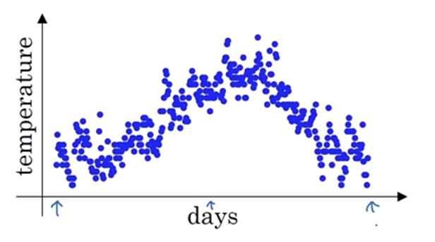

# Week 5 — Practical Aspects of Deep Learning
## 한 문장 요약
다양한 최적화 방법들에 대해 공부하였다. Gradient Descent의 변형 방법인 mini-batch gradient descent부터, momentum, RMSprop, ADAM 등을 공부하였다.

### Mini Batch Gradient Descent
전체 데이터에 대한 gradient를 구해서, 파라미터를 업데이트 하는 방식을 gradient descent(or batch gradient descent)라고 지칭한다.
mini batch gradient descent는 전체 데이터 수 중 일부의 데이터의 gradient를 구해서 파라미터를 업데이트 하는 방식이다.

'전체'를 보고 모든 가중치를 조정하는 방법은 정확하지만, 시간이 오래걸린다.
따라서, '일부'만 보고 가중치를 조정하는 방법을 사용하여, 기존 방법에 비해 빠르게 수렴하는 것이다.

이때, 모든 데이터셋에 대해서 gradient descent가 일어난다는 것에 유의해야한다.
전체 데이터셋이 10,000개가 있었고 한 번에 100개의 데이터셋을 사용한다면, 100개의 데이터셋을 100번 확인하여, gradient를 구해 파라미터를 업데이트한다.

이 과정에서 순간적으로 loss가 커질 수 있지만(fluctuation 발생), 최종적으로는 gradient descent와 동일한 loss에 수렴하게 된다.

### Gradient Descent with Momentum
momentum은 지나온 궤적(or 방향)을 이용하여, mini batch gradient descent를 사용했을 때 발생하는 fluctuation을 줄이는 기법이다.
momentum을 알기 전, 지수 가중 이동 평균(Exponential Weighted Moving Average, EWMA)에 대해서 이해해야한다.

위 온도 그래프의 이동 평균을 계산하는 식은 아래와 같다.

$$V_0 = 0$$
$$V_1 = 0.9 \times V_0 + 0.1 \times \text{temp}_1$$

이때, t번째 시점의 일반식은 다음과 같고, 

$$V_t = 0.9 \times V_{t-1} + 0.1 \times \text{temp}_t$$

상수값 또한 일반화하면 아래와 같이 나타낼 수 있다.

$$V_t = \beta \times V_{t-1} + (1 - \beta) \times \text{temp}_t$$

B는 이전 온도를 얼마나 반영할 것인지, 나타내며 1- B는 현재의 온도를 얼마나 반영할 것인지 나타낸다.

이때, B 값에 따라 몇 일만큼의 이동을 반영할지 유추할 수 있다.
1 / (1-B)만큼의 이동 평균을 반영한다고 나타낼 수 있다.

추가로, 초기 학습 값을 0으로 초기화했기 때문에 초기 그래프가 정확하게 평균치를 추정하지 못할 수 있다.

이를 보상하기 위해 Bias correction이라는 방식을 사용한다.
$$\text{Corrected } V_t = \frac{V_t}{1 - \beta^t}$$

### RMSProp
momentum이 이전 방향을 반영했다면, RMSProp은 크기를 반영하는 방식이다.

식은 아래와 같다.

  $$S_t = \beta_2 S_{t-1} + (1 - \beta_2) g_t^2$$
  $$W_{t+1} = W_t - \frac{\alpha}{\sqrt{S_t} + \epsilon} g_t$$

  g_t의 제곱은 element-wise하게 제곱하여, 크기를 기록하는 방식이다.

  momentum은 -10, 10, -10, 10과 같이 이동한 전적이 있으면 더 이상 진동하지 않도록 이전 값을 반영하였다면

  RMSProp은 각 전적에 제곱을 한 뒤, 100, 100, 100, 100 이후 제곱근을 취하여, 크기를 구하는 방식이다. -> 10, 10, 10, 10

  현재까지의 변형 크기로 현재 gradient를 나눔으로써, fluctuation이 심하면 누적된 크기가 크기 때문에 분모가 커진다. 즉, 파라미터가 적게 업데이트되며 fluctuation이 별로 없다면 누적 크기가 작기 때문에 분모가 작아서 더 크게 파라미터 업데이트가 가능해진다.

  ### ADAM
  Adaptive Moment Estimation은
  이전의 크기와 방향을 모두 고려하여 적용하는 최적화 방법이다.

  $$m_t = \beta_1 m_{t-1} + (1 - \beta_1) g_t$$
$$v_t = \beta_2 v_{t-1} + (1 - \beta_2) g_t^2$$

$$W_{t+1} = W_t - \frac{\alpha}{\sqrt{{v}_t} + \epsilon} {m}_t$$

### Learning Rate Decay
이는 epoch가 진행됨에 따라서, learning rate를 줄여 학습 효율을 증대시키는 방법이다.

$$lr = \frac{1}{1 + \text{decay\_rate} \times \text{epoch\_num}} \times lr_0$$

이를 통해 최솟값에서 더 빠르게 수렴이 가능해진다.

이때, 계단식으로 특정 epoch 마다, 혹은 지수적으로 이를 업데이트가 가능하도록 만들 수도 있다.