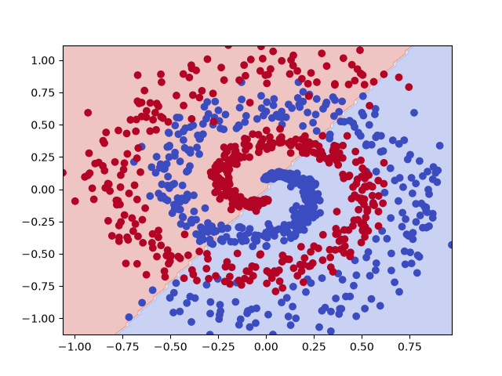
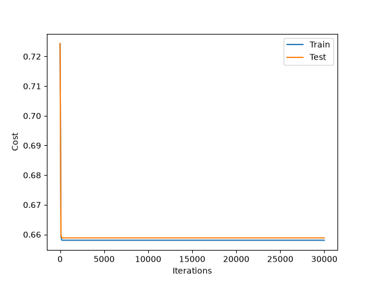
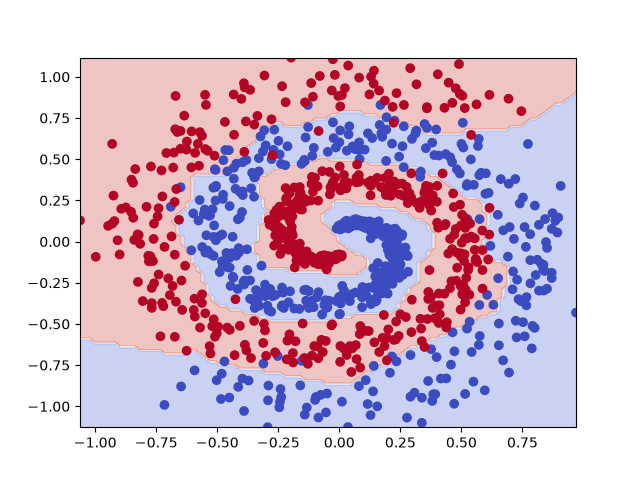
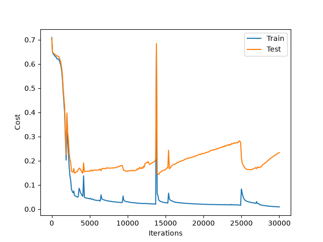
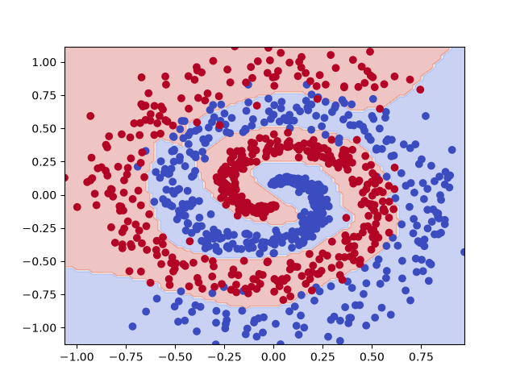
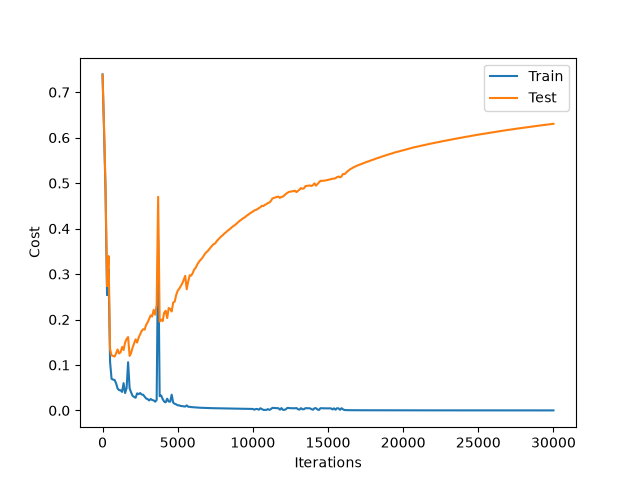
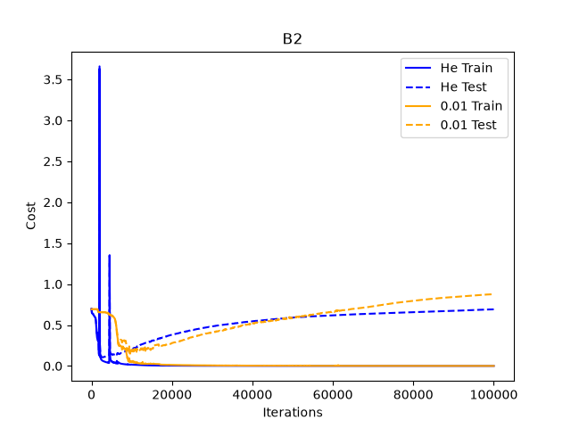
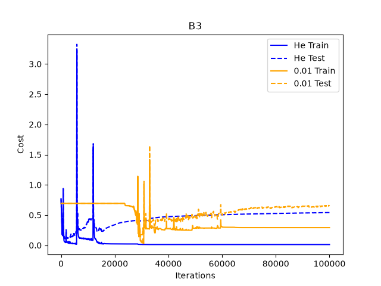

# 과제 3 — L층 신경망

## 구현 요약
지금까지 배운 내용을 종합 사용하여, Deep Neural Network을 구현하였습니다.
## 검증 결과
- 기울기 검증 상대 오차: 4.721e-09
- 환원 검증: [2,1] + 0 초기화 결과 : 일치
    - 로지스틱 회귀 결과 : 
        - W: [[-1.0714453   0.74138787]]
        - b: 0.0017189735372643749
    - Deep nn 결과 :
        - W: [[-1.0714453   0.74138787]]
        - b: 0.0017189735372643749
- [2,16,16,1] 시험 정확도:
    - Training accuracy : 100.00%
    - Test accuracy : 95.40%

## 실험 A — 깊이와 너비 (기본 iteration : 30000)
| # | `layer_dims` | 파라미터 수 | 학습 정확도 | 시험 정확도 | 시험 비용 최소 지점 |
|---|---|---|---|---|---|
| A-1 | `[2, 1]` | 3 |61.50% | 61.70%| iter : 300, idx : 3|
| A-2 | `[2, 16, 1]` | 65 |59.75% | 58.90% | iter: 3200, idx : 32|
| A-3 | `[2, 64, 1]` | 257 | 84.75% | 80.60% | iter: 29600(max : 30000), idx:296|
| A-3 | `[2, 64, 1]` | 257 | 87.75% | 84.30% | iter: 73400(max : 100000), idx:734|
| A-4 | `[2, 256, 1]`| 1025 | 99.25%| 95.60%| iter:22200, idx: 222|
| A-5 | `[2, 16, 16, 1]` |337 | 100.00% | 95.40% | iter: 14100, idx : 141 |
| A-6 | `[2, 32, 16, 8, 1]` | 769| 100.00%| 95.00%| iter: 800, idx: 8|
| A-7 | `[2, 64, 32, 16, 8, 1]` | 2945| 74.75%| 74.30%| iter: 500, idx: 5|
| A-8 | `[2, 256, 8, 1]` | 2833| 99.75%| 96.00%| iter: 3000, idx: 30|

### A1 결정 경계 이미지 

### A5 결정 경계 이미지 

### A6 결정 경계 이미지 

### A5, A6 seed 변경 실험
| # | seed 0 | seed 1 | seed 2 |
|---|---|---|---|
| A-5 | 95.30% | 95.40% | 95.50% |
| A-6 | 90.30% | 95.10% | 86.30% |

## 생각해볼 것

- **A-2에서 A-4로** 은닉 유닛을 16에서 256으로 늘리면 성능이 어떻게 변하는가? 얕은 망으로도 이 데이터를 풀 수 있는가?  
> 얕은 신경망의 hidden layer unit 개수를 16 - > 256으로 늘렸더니, 테스트 정확도는 58.90%에서 95.60%로 증가했다. 얕은 망을 사용하더라도, unit 개수가 늘어나자 복잡한 패턴의 학습이 가능했다.
- **A-4와 A-5를 비교하라.** 두 설정의 시험 정확도와 파라미터 수를 나란히 놓고 보라. 무엇이 보이는가?  
> A-4는 A-5보다 약 3배 정도 많은 파라미터를 가지고 있지만, 비슷한 성능을 나타내고 있었다. 이로써, 층을 깊게 만드는 것은 곧 학습할 파라미터의 수를 줄이고, 성능은 높일 수 있음을 알 수 있었다.
- **A-3과 A-5의 "시험 비용 최소 지점"을 비교하라.** 두 설정은 파라미터 수가 비슷하다(257개 대 337개). 같은 성능에 도달하는 데 각각 몇 번이 걸렸는가?  
> A-3의 비용이 최소가 되는 시점은 73400회, A-5는 14100회였다.
파라미터 수는 비슷하지만, A-5는 층의 깊이를 늘려서, 해당 지표를 달성하였다.
- 위 셋을 합치면 **"깊게 하면 무엇이 좋아지는가"** 에 답할 수 있다. **"얕으면 불가능하다"는 답은 틀렸다.** 좋아지는 것이 두 가지 있다. 둘 다 적어라.
> 깊이가 깊어지면,   
1)학습에 필요한 파라미터 수가 감소하고,   
2)학습 효율이 증가한다.   
이는 하나의 레이어가 표현할 수 있는 표현력에 한계가 있는데, 깊이를 깊게 쌓음으로써, 표현력을 높일 수 있으며, 이로인해, 비슷한 파라미터 수를 가지더더라도, 최소 비용에 도달하는 시간이 줄어든다고 해석할 수 있다.
- seed 변경 실험에서 하나가 유난히 낮은 결과를 보인 이유?
> A-6의 테스트 정확도는 seed에 따라 최솟값은, 86.30% 최댓값은 95.10%로 달라졌다. seed에 따라, 초기 가중치 설정이 잘못되어 local minimum에 빠졌을 가능성을 시사한다.

## 실험 B — 초기화 스케일
### seed 42
| # | `layer_dims` | 30,000회 He | 30,000회 `× 0.01` | 100,000회 He | 100,000회 `× 0.01` |
|---|---|---:|---:|---:|---:|
| B-1 | `[2, 16, 1]` | 58.90% | 68.50% | 59.20% | 68.50% |
| B-2 | `[2, 16, 16, 1]` | 95.40% | 61.40% | 94.90% | 95.00% |
| B-3 | `[2, 32, 16, 8, 1]` | 95.00% | 95.10% | 95.10% | 71.00% |
### seed 1
| # | `layer_dims` | 30,000회 He | 30,000회 `× 0.01` | 100,000회 He | 100,000회 `× 0.01` |
|---|---|---:|---:|---:|---:|
| B-1 | `[2, 16, 1]` | 64.70% | 61.50% | 65.00% | 61.40% |
| B-2 | `[2, 16, 16, 1]` | 95.40% | 94.90% | 95.40% | 93.80% |
| B-3 | `[2, 32, 16, 8, 1]` | 95.10% | 95.00% | 95.00% | 81.30% |
### seed 12
| # | `layer_dims` | 30,000회 He | 30,000회 `× 0.01` | 100,000회 He | 100,000회 `× 0.01` |
|---|---|---:|---:|---:|---:|
| B-1 | `[2, 16, 1]` | 63.90% | 70.40% | 77.40% | 70.40% |
| B-2 | `[2, 16, 16, 1]` | 90.60% | 71.00% | 63.80% | 90.00% |
| B-3 | `[2, 32, 16, 8, 1]` | 90.90% | 91.40% | 66.80% | 61.90% |

## 생각해볼 것
- 층이 깊어질수록 두 초기화의 차이가 어떻게 변하는가?
> B2, B3 비교표를 확인해보았을 때, 층이 깊어질수록 cost가 일정하게 감소 or 증가하지 않고 튀는 경향을 보였고, 난수 초기화는 신경망의 층이 깊어질수록 정확도가 감소하는 양상을 보였습니다.
- `0.01` 로 초기화한 3층·4층의 시험 정확도를 **A-1(로지스틱 회귀)의 값과 비교**해 보라. 무엇을 알 수 있는가?
> 비교적 높은 성능을 보인 seed1의 결과를 제외하고 보면, 0.01로 초기화하고, 충분히 학습한(iteration : 1e5) 3층, 4층에서는 seed 12, 42는 로지스틱 회귀값과 비슷한 양상을 보였습니다. 따라서, 순전파와 역전파 과정에서 작은 가중치가 원인이 되어 학습이 잘 일어나지 않았음을 시사합니다.
- 가중치를 작게 시작하면 층을 지날 때마다 신호가 어떻게 되겠는가? 그 신호가 작아지면 역전파로 돌아오는 기울기는 어떻게 되겠는가?
> relu와 같은 활성화 함수를 사용하면 값을 그대로 사용하거나, 0을 사용하기 때문에 가중치가 작으면 순전파 과정에서 매우 작은 값이 전달될 가능성이 있습니다. 역전파 과정에서도 작은 가중치가 반복해서 적용되므로, 가장 앞쪽에 있는 파라미터가 학습될 기회가 사라지게됩니다.
## 막혔던 것
대부분 역전파 함수를 만들 때, 기울기를 구하는 과정이 헷갈려서 애를 먹었습니다.

## 아직 모르겠는 것

## 질문

1. **A-1(로지스틱 회귀)** 은 나선 데이터에서 왜 60% 근처에 머무는가. 과제 2의 초승달 데이터에서는 86%였는데 왜 더 낮아졌는가.
> 초승달 데이터는 데이터 분류 시, 비교적 간단한 곡선으로도 데이터를 잘 분류할 수 있었습니다.   
다만, 나선 데이터의 경우, 각 데이터에 대해 주변에 분포하는 다른 특성의 밀집도가 높았기에 간단한 선으로 복잡하게 얽힌 데이터를 분류하기 어려웠고, 이로인해 정확도가 더 낮아졌다고 이해했습니다.
2. **A-4(2층, 은닉 256)와 A-5(3층, 16-16)** 의 시험 정확도와 파라미터 수를 비교하면 무엇을 알 수 있는가.
> 층이 더 깊어지면, 더 적은 파라미터로도 비슷한 성능을 도출할 수 있었습니다.
3. **A-3(2층, 은닉 64)과 A-5(3층, 16-16)** 는 파라미터 수가 비슷하다. 같은 성능에 도달하는 데 걸린 반복 횟수를 비교하면 무엇을 알 수 있는가.
> 파라미터가 비슷하더라도, 층의 깊이가 깊어진다면 더 빠르게 같은 성능에 도달할 수 있어 학습 효율이 더 좋다고 이해했습니다.
4. 2번과 3번을 합쳐서, **깊게 쌓으면 좋아지는 것 두 가지**를 말하라.
> 1)학습에 필요한 파라미터 수가 감소한다.   
2)학습 효율이 증가한다.  
5. **실험 B에서 `0.01` 로 초기화한 3층 망**의 성능이 A-1과 비슷하게 나왔다면, 그 망은 사실상 무엇과 같아진 것인가.
> 성능상으로는 로지스틱 회귀와 비슷하게 머물렀다고 이해할 수 있었습니다. 
6. **A-6(4층)을 seed 3개로 돌린 결과**가 서로 많이 다르다면, 그 이유는 무엇이겠는가. 그리고 논문에 성능을 보고할 때 이 사실이 왜 중요한가.
> 초기화하는 가중치에 따라, global minimum이 아닌, local minimum에 빠질 가능성이 존재합니다. 따라서, seed 하나로 실험 결과를 단정 짓는 것이 아닌, 여러 개의 seed로 가중치를 초기화하고 실험 결과를 종합하여 오차 범위까지 제공해야 했습니다.
7. 과제 1부터 지금까지 만든 모델은 로지스틱 회귀 → 2층 → L층으로 이어진다. **뒤의 것이 앞의 것을 포함한다는 사실을 코드로 어떻게 확인했는가.**
> 환원 검증 과정을 통해서, 이번에 만든 deep-nn이 이전에 만든 로지스틱 회귀와 동일한 결과를 보임을 확인할 수 있었습니다.
