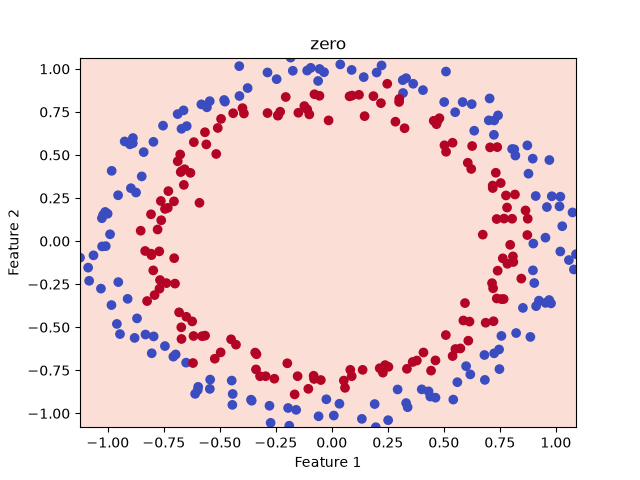
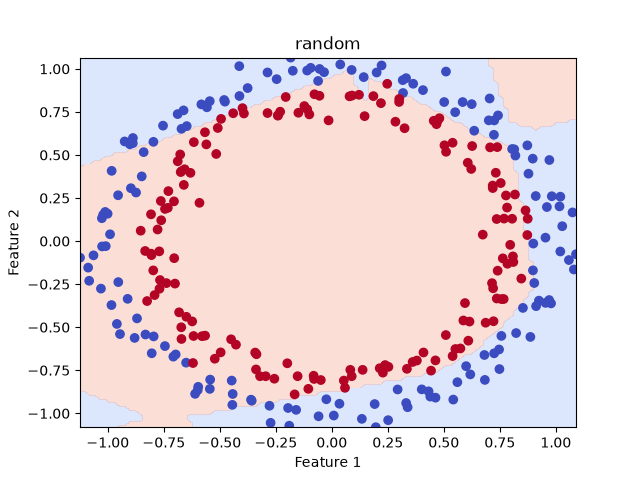
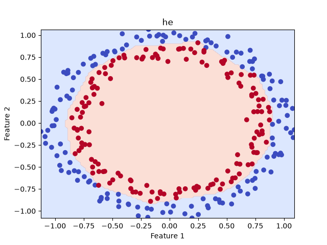
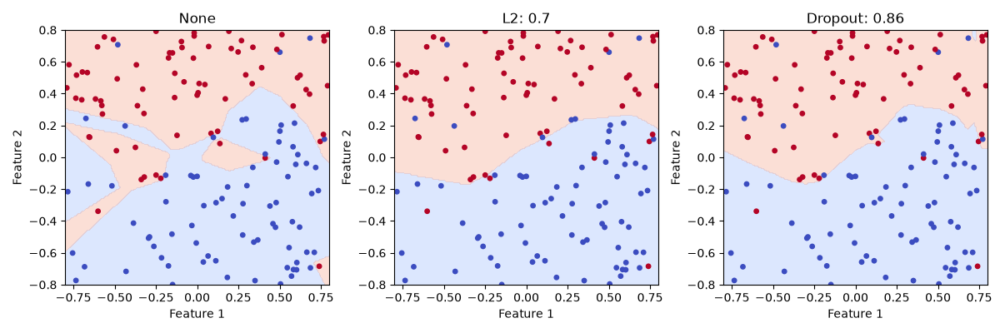
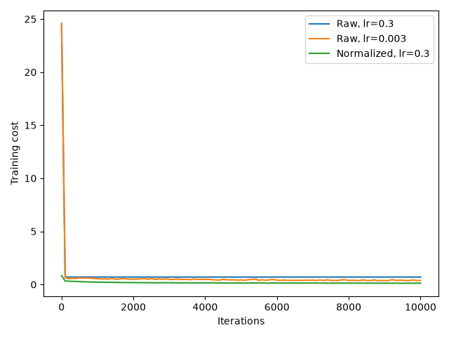

## 4-1. 초기화 실험
### 기록

| # | 0회 시점 비용 | 최종 학습 비용 | 학습 정확도(%) | 시험 정확도(%) |
|---|---|---|---|---|
| 1 | 0.6931|0.6931 | 50.00 | 50.00|
| 2 | 1773.5860| 0.3810| 83.00 | 86.00|
| 3 | 0.8831| 0.0648| 99.33 | 96.00|

### 0 초기화 결정 경계

### random 초기화 결정 경계

### he 초기화 결정 경계

### 질문

1. 0 초기화의 결과를 설명하라.
> 0 초기화는 symmetry가 깨지지 않았습니다.   
이는 모든 가중치가 동일한(대칭성을 가지는) 값을 가지게 되는 현상을 의미하며, symmetry가 존재하면, forward propagation의 activation 값과 backward propagation 시점에 계산되는 기울기가 모두 동일하여 학습이 진행되지 않습니다.
2. `randn * 10` 초기화에서 0회 시점 비용이 큰 이유는 무엇인가.
> 말 그대로 큰 값을 사용하여, 초기화를 진행했기 때문에 초기 시점(0회)에 전달되는 activation 값이 크게 설정되었고, 이 때문에 해당 시점에서 비용이 크게 나타났다고 해석하였습니다.
3. 과제 3 실험 B에서는 `randn * 0.01` 을 썼다. 너무 작은 경우와 너무 큰 경우는 각각 무엇이 문제인가.
> 너무 작은 경우에는 기울기 소실 현상이 발생할 수 있고, 너무 큰 경우에는 기울기 폭발이 일어날 수 있습니다.

## 4-2 Regularization 실험
| λ | 학습 정확도 | dev 정확도 | `W` 크기 |
|---|---|---|---|
0 | 97.33% | 79.90% | 29.0166
0.1 | 93.33% | 83.80% | 13.7670
0.7 | 90.00% | 85.30% | 5.0068
3 | 88.00% | 82.70% | 2.9663
30 | 51.33% | 47.60% | 0.0000

| keep_prob | 학습 정확도 | dev 정확도 |
|---|---|---|
1.0 | 97.33% | 79.90%
0.86 | 92.00% | 85.90%
0.5 | 88.67% | 82.10%

| 모델 | 학습 정확도 | dev 정확도 | 시험 정확도 |
|---|---|---|---|
정규화 없음 | 97.33% | 79.90% | 82.80%
L2, (가)에서 고른 λ: 0.7 | 90.00% | 85.30% | 87.00%
dropout, (나)에서 고른 keep_prob: 0.86 | 92.00% | 85.90% | 88.10%

### 질문
4. 정규화 없음 모델과 L2 모델의 결정 경계는 어떻게 다른가.
> 정규화가 없는 모델은 과적합이 되었지만, L2 정규화 model을 적용하였더니 과적합이 줄었습니다.
5. λ가 커질수록 `W` 의 크기는 어떻게 변하는가. 그것이 결정 경계와 어떤 관계가 있는가.
> 람다값이 커지면 손실이 커집니다. 따라서, W에 대한 손실을 줄이기 위해 W를 0에 가깝게 줄이게 됩니다.   
가중치가 0에 가깝게 줄어들면 학습을 거의하지 못해 결정 경계의 의미가 없어지고, 반대로 람다 값이 작으면 과적합이 발생한 결정경계를 그리게 됩니다.
6. λ = 30 의 결과를 설명하라.
> 람다값이 커서, 가중치가 조금만 크더라도 이에 대한 손실이 커졌고, 손실을 줄이기 위해 가중치를 0에 가깝게 설정하였습니다.  
이로 인해 가중치가 제 역할을 하지 못해 학습이 제대로 진행되지 못했습니다.
7. dropout을 학습할 때만 켜고 평가할 때는 끄는 이유는 무엇인가. `/ keep_prob` 로 나누는 이유는 무엇인가.
> dropout은 특정 노드의 의존도를 줄이기 위해 사용합니다. dropout을 통해 학습이 끝나면 각 노드가 적절한 가중치를 부여받은 상태가 되기 때문에 예측 시점에 dropout을 적용하는 것은 잘못된 예측결과를 도출할 수 있습니다. 그리고 마스킹 이후 keep prob으로 나누는 이유는 dropout을 통해 꺼진 노드들의 activation 값을 보상하기 위해서입니다.
8. λ와 keep_prob를 시험 데이터가 아니라 dev 데이터로 고른 이유는 무엇인가.
> 시험 데이터를 사용하면 cheating이고 최종 예측에 사용되어야하기 때문입니다.
9. (다)에서 dev 정확도와 시험 정확도는 같은가. 같지 않다면 무엇을 뜻하는가.
> 일반적으로 dev를 기준으로 모델을 재학습 했으니, dev 정확도가 더 높게 나와야될 것 같은데 이번 실험에서는 test 정확도가 더 높게 나왔습니다.  
이 부분에 대해서는 결과를 어떻게 해석해야할지 잘 모르겠습니다.
두 데이터 개수는 같았기에, seed에 따른 차이가 발생한 것이지 않을까 예상하고 있습니다. 

## 4-3 Input Normalization 실험

| # | 0회 시점 학습 비용 | 500회 시점 학습 비용 | 최종 학습 비용 | 학습 정확도 |
|---|---|---|---|---|
Raw, lr=0.3 | 24.5786 | 0.6928 | 0.6928 | 51.33%
Raw, lr=0.003 | 24.5786 | 0.6161 | 0.3732 | 85.33%
Normalized, lr=0.3 | 0.8322 | 0.2677 | 0.1182 | 95.33%

### 질문
10. 정규화하지 않은 입력에서 학습률 0.3과 0.003의 결과가 다른 이유는 무엇인가.
> 정규화를 진행하지 않았을 떄 feature의 분포 간 차이가 크면 분산이 큰 feature에 대해서는 contour map이 한 축으로 길게 늘어진 양상을 띄게 됩니다. 이때, 학습률을 크게 설정하면 gradient가 튀어버리는 형태를 나타내게 됩니다.
11. 정규화한 모델을 dev나 시험 데이터로 평가할 때는 학습 데이터로 구한 `mu`, `sigma` 를 그대로 쓴다. dev나 시험 데이터 자신의 평균·표준편차를 쓰면 안 되는 이유는 무엇인가.
> 학습을 진행할 때, training dataset을 기준으로 정규화를 진행했습니다. dev or test set으로 예측을 진행할 때 이들의 데이터의 평균과 표준편차를 사용하면 데이터가 왜곡되게 됩니다.

## 4-4 Gradient Check 실험
### `J(θ) = θ · x` 에 대해 `θ = 3`, `x = 2` 일 때 수치 미분과 해석 미분을 비교

> - 수치 미분 : 1.9999999967
> - 해석 미분 : 2.0000000000
> - 상대 오차 : 8.183e-10

### N차원 gradient check 실험
>- `layer_dims = [4, 5, 3, 1]`, 입력 `X` 는 `(4, 20)` 크기의 표준정규 난수, `Y` 는 0 / 1 난수
> - 과제 3에서처럼 `b` 를 작은 난수로 두고 검증한다.

| # | 조건 | 상대 오차 |
|---|---|---|
| 1 | 정상 | 2.293e-09 |
| 2 | 역전파에서 `dW2` 에 2를 곱하는 버그를 일부러 넣음 | 1.992e-01 |
| 3 | dropout을 켬 (keep_prob = 0.86) | 1.868e-09 |

### 질문

12. 2번에서 버그는 검출되었는가.
> 의도대로 기울기가 불일치하여 상대 오차가 크게 검출되었습니다.

## 막혔던 것

## 아직 모르겠는 것
- (다) 실험에서 dev set의 정확도가 더 높게 측정되었는데, 그 이유를 잘 모르겠습니다.