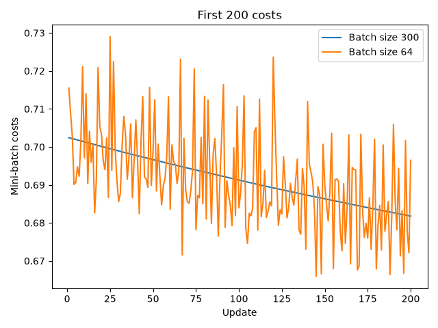
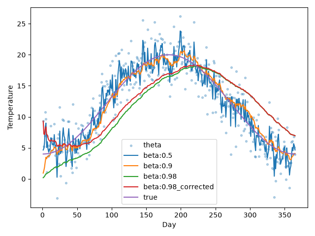
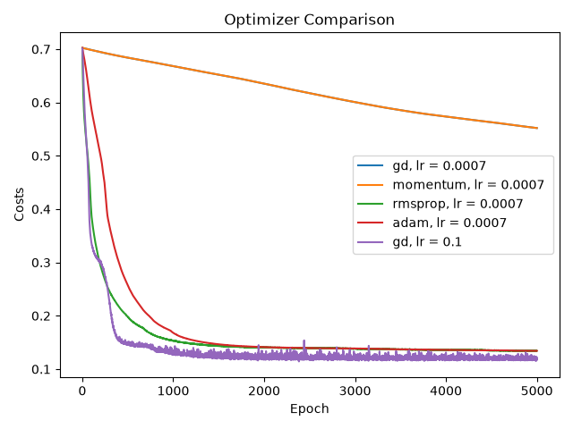
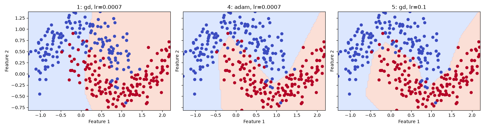
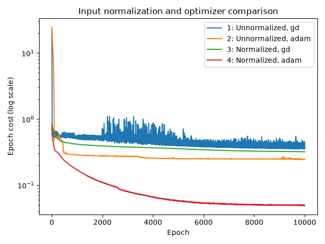
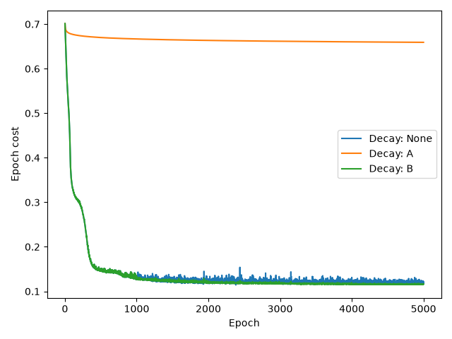
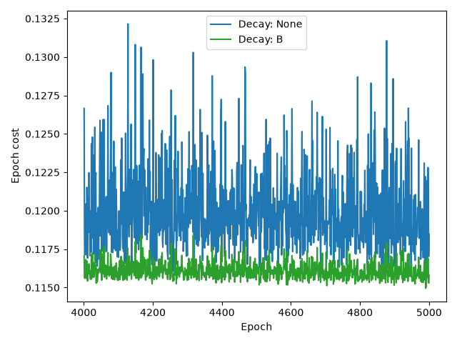

## 5-1. mini-batch 실험
| 크기 | 1 epoch당 업데이트 횟수 | 100 epoch 비용 | 최종 비용 | 학습 정확도 | dev 정확도 | 걸린 시간 |
|---|---|---|---|---|---|---|
| 300 (전체) | 1 | 0.691257 | 0.605210 | 68.00% | 66.40% | 0.16초 |
| 64 | 5 | 0.654754 | 0.336194 | 86.67% | 86.90% | 0.54초 |
| 1 | 300 | 0.158930 | 0.121776 | 95.67% | 96.40% | 20.01초 |

### 첫 200회 업데이트 cost 변화

### 질문
1. 같은 1,000 epoch인데 크기에 따라 결과가 다른 이유는 무엇인가.
> 업데이트하는 횟수가 차이가 나기 때문입니다. 가장 차이가 큰 batch_size = 300과 1을 비교하자면
batch_size = 300인 경우에는 한 번에 300개의 데이터를 고려하여, 이들의 평균값으로 가중치를 업데이트합니다.
반면, batch_size = 1인 경우에는 300번의 업데이트가 이루어집니다.
이때, 이전에 변경된 가중치를 사용하기 때문에 더 빠르게 적은 epoch으로 성능 향상을 기대할 수 있는 것입니다.
2. 그림에서 크기 64의 비용이 들쭉날쭉한 이유는 무엇인가.
> shuffled된 데이터셋의 cost를 줄이는 방향이 전체 크기의 cost를 줄이는 방향과 다를 경우 cost가 일시적으로 크거나, 줄어드는 fluctuation 현상이 나타날 수 있기 때문입니다. 
3. 크기 1은 epoch 수로 따지면 비용이 가장 빨리 줄어든다. 걸린 시간으로 따지면 어떤가. 왜 그런가.
> 1)에서 언급한 내용과 동일하게 1번의 epoch 당 배치 사이즈가 큰 경우에는 전체 가중치를 고려하여, 한 번에 업데이트하는 반면 배치 사이즈가 작은 경우에는 해당 배치 사이즈 내의 가중치만 고려해서 업데이트를 진행하고 변경된 가중치를 사용하여 업데이트가 진행되기 때문에 minimum cost로 줄어드는 속도는 빠르지만 걸린 시간은 더 오레 걸리게 됩니다. (더 많은 함수 호출 등이 요구되기 때문)

---
## 5-2. 지수 가중 이동 평균

| 방법 | 1일 | 10일 | 50일 | 200일 |
|---|---|---|---|---|
| `theta` | 9.2933 | 5.3500 | 6.1466 | 23.6493 |
| `true` | 4.0012 | 4.1182 | 6.7848 | 19.6397 |
| β = 0.5 | 4.6467 | 4.8215 | 5.1592 | 23.7377 |
| β = 0.9 | 0.9293 | 3.8016 | 5.0923 | 20.5783 |
| β = 0.98 | 0.1859 | 1.1299 | 3.3671 | 17.5458 |
| β = 0.98, correction | 9.2933 | 6.1768 | 5.2957 | 17.8599 |

`theta` 를 점으로 찍고, 네 곡선을 한 그림에 그린다.

### 질문

4. β가 클수록 곡선은 어떻게 변하는가. 200일에서 β = 0.5와 β = 0.98의 값이 각각 `true` 와 차이 나는 이유는 무엇인가.
> β가 클수록 곡선이 오른쪽으로 살짝 이동했으며, 평탄한 모양을 보입니다.
v는 이전 온도를 반영하고 있는 정보이며, theta는 현재 일자의 온도를 나타냅니다. v에는 β가 곱해지는데 β가 작을수록 현재 온도를 반영하는 정도가 높아져, 급격한 변화에 반영하는 정도가 높아집니다.(Fluctuation이 큼)
β가 크면 이전의 변화를 가중하는 정도가 높아져, 급격한 온도 변화가 일어나도 평탄한 양상을 나타냅니다.
5. bias correction을 하지 않으면 앞부분이 작게 나오는 이유는 무엇인가. 1일의 값으로 설명하라.
> 초기 v = 0.0으로 설정하였습니다. 따라서, 이후 평균값은 일자를 1-β만큼만 반영하여 나타내고 있기 때문에 (1-β**t)로 나누어 적용하면 사라지는 값이 보상되는 효과를 가져옵니다.s
---
## 5-3. 최적화 방법 비교

### (가) moons 데이터

| # | 방법 | 학습률 | 1,000 epoch 비용 | 최종 비용 | 학습 정확도 | dev 정확도 |
|---|---|---|---|---|---|---|
| 1 | gd | 0.0007 | 0.668133 | 0.551997 | 71.67% | 71.40% |
| 2 | momentum | 0.0007 | 0.668200 | 0.552078 | 71.67% | 71.40% |
| 3 | rmsprop | 0.0007 | 0.153181 | 0.134231 | 94.33% | 96.50% |
| 4 | adam | 0.0007 | 0.167957 | 0.134225 | 94.33% | 96.50% |
| 5 | gd | 0.1 | 0.132077 | 0.118463 | 94.67% | 97.10% |

### 최적화 방법 학습곡선 비교

### 최적화 방법 결정 경계 비교 1,4,5

### (나) 과제 4-3 데이터
| # | 입력 | 방법 | 500 epoch 비용 | 최종 비용 | 마지막 1,000 epoch 비용의 최솟값 ~ 최댓값 | 학습 정확도 |
|---|---|---|---|---|---|---|
| 1 | 정규화하지 않음 | gd | 0.566630 | 0.356421 | 0.351553 ~ 0.543536 | 86.00% |
| 2 | 정규화하지 않음 | adam | 0.308777 | 0.246413 | 0.245515 ~ 0.270653 | 90.00% |
| 3 | 정규화함 | gd | 0.445473 | 0.319918 | 0.319918 ~ 0.322946 | 87.33% |
| 4 | 정규화함 | adam | 0.233603 | 0.049277 | 0.048910 ~ 0.050652 | 96.67% |

### 최적화 및 정규화 기법 비교

### 질문
6. (가)에서 GD와 Momentum의 결과가 거의 같은 이유는 무엇인가.
> GD가 Momentum과 다른 점은 이전의 변화(방향)를 사용한다는 점입니다. 이때, 작은 학습률을 사용하면 이전 변화가 매우 작아 결국 GD와 비슷한 가중치를 사용하게 되고, 이 때문에 두 최적화 기법이 비슷한 정확도를 보이는 것으로 보입니다.
7. (가)의 1번과 4번만 보면 Adam이 GD보다 훨씬 좋아 보인다. 5번까지 보면 무엇을 알 수 있는가.
> 최적화 기법이 아닌 학습률 또한 고려하여, 판단을 내려야함을 의미합니다. 큰 학습률을 사용한 GD는 적은 epoch으로 학습이 충분하게 진행되었고 Adam과 비슷한 성능을 도출하였습니다.
8. 학습률 0.0007에서 Adam은 학습이 잘 되는데, GD는 왜 매우 느린가. 두 방법의 업데이트 식에서 한 번에 움직이는 크기를 비교해 설명하라.
> Adam은 Momentum과 RMSProp을 사용하여 만들어진 식입니다.
이때, Momentum을 이용하여, 현재까지의 기울기 변화를 반영하기 때문에 현재까지 기울기가 가파른 상태였다면, 빠르게 이동하게 됩니다. 
9. (나)에서 정규화하지 않은 입력으로 학습할 때 GD와 Adam의 비용 곡선은 어떻게 다른가. 그 이유는 무엇인가.
>  둘 다 정규화된 입력을 사용하면 더 좋은 성눙이 나왔습니다.
정규화는 학습이 원활하게 진행되도록 만드는 기법으로도 이해할 수 있습니다.
한 축으로 길게 늘어지지 않기 때문에 안정적으로 cost를 업데이트 할 수 있으며, 이동 평균도 예측 가능하게 사용이 되기 때문에 더욱 빠르게 업데이트 될 수 있음을 확인할 수 있었습니다.
10. (나)의 2번과 4번을 비교하라. Adam을 쓰더라도 입력 정규화가 필요한가.
> 최종 비용과 학습 정확도가 모두 유의미하게 향상되었으므로 사용하는 것이 좋습니다. 

---
## 5-4. 학습률 감쇠
| # | 감쇠 | 최종 비용 | 마지막 1,000 epoch 비용의 (최댓값 − 최솟값) | 학습 정확도 | dev 정확도 |
|---|---|---|---|---|---|
| 1 | 없음 | 0.118463 | 0.016653 | 94.67% | 97.10% |
| 2 | 방식 A | 0.659174 | 0.001049 | 65.00% | 64.00% |
| 3 | 방식 B | 0.115820 | 0.003431 | 94.33% | 97.20% |

### 세 방법 비교

### 두 방법 마지막 1000 epoch 비교

### 질문

11. 방식 A의 결과를 설명하라. 100 epoch 뒤와 5,000 epoch 뒤의 학습률은 각각 얼마인가.
> 세 방식 중 가장 정확도가 낮게 나왔습니다. 이는 학습률이 지나치게 빠르게 낮아져서 epoch 동안 학습이 충분하게 진행되지 않은 결과로 이해할 수 있습니다.
100 epoch : 0.0009900990099009901  
5000 epoch: 1.9996000799840032e-05
12. 방식 B는 감쇠 없음과 비교해 무엇이 달라졌고, 무엇이 그대로인가.
> 정확도의 경우 거의 근사하게 결과가 도출되었습니다.
B의 방식을 취하고 나니, 마지막 1000 epoch 비용의 변동폭이 대략 1/5 수준으로 줄어들었습니다. 이는, lr이 계속해서 감쇠한 결과라고 이해하였습니다.

## 아직 잘 모르겠는 것
1. 이미지 처리 시에는, ADAM이 아닌 SGD + Momentum 조합도 종종 사용되는 것으로 알고 있습니다. 이에 ADAM이 성능(수렴 속도)면에서 훨씬 우월할 것인데, SGD + Momentum을 사용하는 이유가 궁금했습니다.  

    생성형 AI는 SGD + Momentum이 이미지 처리의 정확도를 극한까지 끌어올리기 때문이라고 답변을 한 상태입니다.  

    이는 optimizer가 속도 측면에서, 너무 빠르게 최적화하는 것보다는 조금 더 헤매며 여러 샘플들을 고려하여 최적화를 하는 것이 정확도 면에서 더 우수하다고 이해하면 될까요?

## 막혔던 것