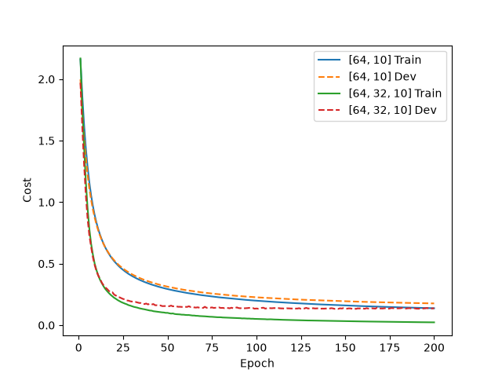
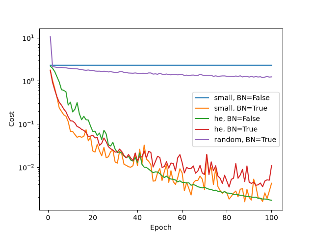
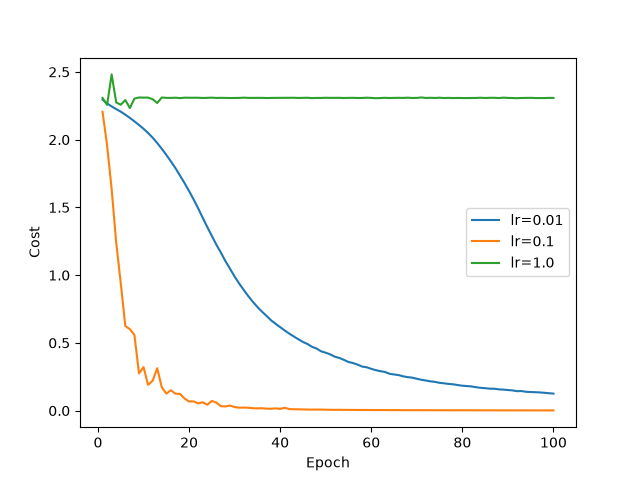
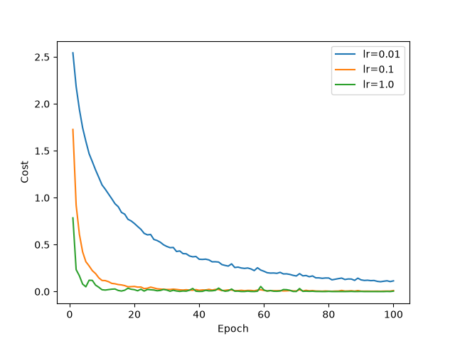
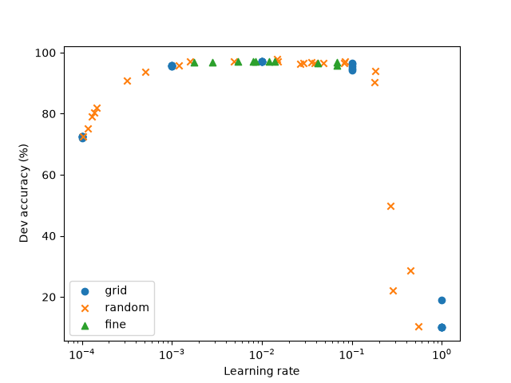

## 6-1. softmax

기울기 검증 상대오차 : 1.7708973145e-08

| 모델 | 초기화 | 초기 비용 | 최종 비용 | 학습 정확도 | dev 정확도 |
|---|---|---|---|---|---|
| [64, 10] | zero | 2.302585 | 0.137636 | 98.0501% | 96.6667% |
| [64, 32, 10] | he | 2.410652 | 0.023089 | 99.9071% | 96.9444% |

#### <두 모델의 train & dev 비용 그림>

### 질문

1. 검증 1에서 최댓값을 빼지 않으면 어떻게 되었는가. 최댓값을 빼도 softmax의 결과가 같은 이유는 무엇인가.
> 최댓값을 빼지 않은 경우 nan이 발생하는데 이는, e의 지수 부분이 1000 이상만 넘어가더라도, overflow가 발생하기 때문입니다. 최댓값을 뺀 softmax의 경우 지수의 뺄셈은 곱의 형태로 재표현이 가능하기 때문에 기존식과 동일하게 변형이 가능합니다.
2. 0으로 초기화한 softmax 회귀의 0회 시점 비용이 ln 10인 이유는 무엇인가.
> 모든 가중치를 0으로 초기화하면 a가 1/10이 되는데, 이때 손실이 -log(1/10)이 되며, 정답과 무관하게 ln10이 되는 것을 확인할 수 있었습니다.
3. 검증 4에서 과제 1과 같은 결과가 나온 학습률은 무엇인가. 왜 그 값이어야 하는가. 학습하는 동안 `W[0]` 과 `W[1]` 은 어떤 관계를 유지하는가.
> 0.25일때, 같은 결과가 나왔었습니다. 이는 기존 logistic regression learning rate가 0.5인 것의 1/2의 값을 가져야 동일한 결과를 획득할 수 있다는 것이고, 둘의 비교를 통해서 (W[1] - W[0]) 학습이 진행되기 때문에 절반의 learning rate를 사용했다 정도로 이해하였습니다.
4. 두 모델의 학습 정확도와 dev 정확도를 비교하라. dev 데이터는 360개다. 샘플 하나는 dev 정확도로 몇 %에 해당하는가. 두 모델의 dev 정확도 차이는 샘플 몇 개인가.
> train 정확도는 98.0501%에서 99.9071%로, dev 정확도는 96.6667%에서 96.9444%로 변경되었습니다. 정확도 차이는 한 샘플 밖에 차이가 나지 않으며, 1/360 * 100은 약 0.2778%p의 차이가 발생했기 때문에 거의 비슷한 성능을 나타내고 있음을 확인하 수 있었습니다.

---

## 6-2. 배치 정규화
기울기 검증 상대 오차 : 1.4057505310e-08

db1:
[[ 8.10983225e-18]
 [ 1.94289029e-17]
 [-5.27355937e-17]
 [ 1.11022302e-17]
 [ 1.80411242e-17]
 [ 6.66133815e-17]
 [-2.22044605e-17]
 [-8.88178420e-17]]

db2:
[[-1.11022302e-17]
 [-1.38777878e-17]
 [ 1.31838984e-17]
 [ 1.04083409e-17]
 [-1.76941795e-17]
 [-4.30211422e-17]]

### 검증
| 층 | 비용 전 | 비용 후 | dW 크기 전 | dW 크기 후 |
|---|---|---|---|---|
| W1 | 2.633156 | 2.633156 | 8.020514e-01 | 8.020544e-02 |
| W2 | 2.633156 | 2.633161 | 5.582468e-01 | 5.582516e-02 |
| W3 | 2.633156 | 12.874039 | 6.852698e-01 | 1.039716e+00 |

파라미터 수 : BN 없음: 5,578개 / BN 있음: 5,706개

### (가) 초기화 스케일

| # | 초기화 | BN | 초기 비용 | 10 epoch 비용 | 최종 비용 | 학습 정확도 | dev 정확도 |
|---|---|---|---|---|---|---|---|
| 1 | `randn * 0.01` | False | 2.302585 | 2.303040 | 2.303193 | 10.1207% | 10.0000% |
| 2 | `randn * 0.01` | True | 2.301055 | 0.067807 | 0.004220 | 100.0000% | 97.5000% |
| 3 | he | False | 2.310022 | 0.321335 | 0.001700 | 100.0000% | 97.2222% |
| 4 | he | True | 2.742637 | 0.118323 | 0.010749 | 100.0000% | 95.8333% |
| 5 | `randn * 10` | False | 58467750.936490 | nan | nan | 9.9350% | 9.7222% |
| 6 | `randn * 10` | True | 63.917447 | 1.957244 | 1.238262 | 56.8245% | 55.0000% |

#### <BN 초기화 곡선>

### (나) 학습률

| BN | 학습률 | 10 epoch 비용 | 최종 비용 | 학습 정확도 | dev 정확도 |
|---|---|---|---|---|---|
| False | 0.01 | 2.080183 | 0.125634 | 97.7716% | 95.8333% |
| False | 0.1 | 0.321335 | 0.001700 | 100.0000% | 97.2222% |
| False | 1.0 | 2.310399 | 2.308048 | 10.1207% | 10.0000% |
| True | 0.01 | 1.136031 | 0.114216 | 99.6286% | 95.5556% |
| True | 0.1 | 0.118323 | 0.010749 | 100.0000% | 95.8333% |
| True | 1.0 | 0.019462 | 0.004638 | 100.0000% | 98.0556% |

#### <BN 없음>

#### <BN 있음>

### (다) 평가 때의 BN

(가)의 4번 모델(He, BN, 학습률 0.1)을 네 가지 방법으로 평가한다.

| # | 평가에 쓰는 `μ`, `σ²` | dev 정확도 |
|---|---|---|
| 1 | 이동 평균 `μ_run`, `σ²_run` | 95.8333%|
| 2 | dev 360개를 한 묶음으로 넣어 구한 통계 | 95.8333%|
| 3 | dev를 앞에서부터 4개씩 묶어 넣고, 묶음마다 구한 통계 | 55.2778%|
| 4 | dev를 1개씩 넣고, 그 샘플 하나로 구한 통계 | 10.0000%|

각 BN 층의 이동 평균 갱신 횟수 : 1700

### 질문

5. 검증 2의 `db` 와 검증 3의 결과를 BN의 식으로 설명하라. 출력층 `W3` 에 10을 곱한 경우는 왜 결과가 다른가.
> Z - u = Wx + b - (mean(WA) + b)인데, 이 과정에서 b가 상쇄되어 정규화 학습 과정에서 어떤 영향도 주지 못하는 상태가 되었습니다. 출력층 W3에는 BN을 적용하지 않으므로 크기 변화가 상쇄되지 않았습니다.
6. (가)의 1번과 (나)의 BN 없음·학습률 1은 비용이 2.3 근처에 머문다. 두 모델에서 마지막 은닉층의 출력과 dev 데이터의 예측을 확인하라. 이 망의 출력은 입력에 따라 어떻게 달라지는가. 2.3은 6-1의 어떤 값과 같은가.
> 두 모델 모두 마지막 은닉층 출력의 표준편차가 0이었기에, 출력층의 logit은 bias 만으로 결정이되었습니다. 결국 각 클래스에 1/10 확률을 부여했을 떄 도출할 수 있는 손실인 ln10과 비슷한 값이었습니다.
7. (가)에서 BN은 `randn * 0.01` 초기화의 문제를 해결했는가. `randn * 10` 은 어떤가. 6번의 0회 시점 비용이 큰 이유와, 6번의 학습이 4번보다 느린 이유를 검증 3의 결과로 설명하라. `W` 가 10배가 되고 `dW` 가 1/10이 되면, 업데이트 한 번에 `W` 가 자기 크기에 비해 얼마나 바뀌는가.
> BN은 결과에 미치는 영향이 상이해도 입력값을 평균 0, 표준편차 1로 맞춰버리기 때문에 줄어든 영향력만큼만 수정을 진행하여 큰 가중치에서 학습이 더디게 진행되었다고 생각합니다.
8. (나)에서 BN이 없을 때와 있을 때, 학습이 되는 학습률의 범위는 어떻게 다른가.
> BN을 사용하면 높은 학습률을 가지고도 학습이 가능했던 것을 확인할 수 있었습니다.
9. (다)의 4번에서 dev 정확도는 얼마이고 예측은 어떻게 나왔는가. 왜 그렇게 되는가. 평가할 때 이동 평균을 쓰는 이유는 무엇인가.
> 정확도가 10%였습니다. 샘플이 하나면 유닛 평균이 자신이 되고, 분산이 0이되어 최종적으로 예측에 영향을 미치는 것은 Beta 밖에 없습니다. 즉, 모든 이미지에 같은 예측을 하게 됩니다. 이런 현상을 방지하기 위해 이동 평균을 사용해서 배치 크기나 샘플에 따라 기준이 달라지는 것을 방지하기 위해 사용했습니다.
10. 이동 평균은 과제 5-2의 지수 가중 이동 평균인데 bias correction을 하지 않았다. 학습을 마쳤을 때 처음값(`μ_run = 0`, `σ²_run = 1`)에 걸린 가중치는 얼마인가. bias correction이 필요 없는 이유는 무엇인가.
> 약 17개의 배치를 100epoch 동안 반복하면, 이동평균이 1700번 갱신되는데, 가장 처음의 가중치가 0.9^1700이 되어 거의 0에 가까운 값이 되기 때문입니다. 즉, 영향이 적기 때문입니다.

## 6-3. 하이퍼파라미터 탐색
### (가) 척도
| 구간 | 균등 | 로그 척도 |
|---|---|---|
| [1e-04, 1e-03) | 3 | 277 |
| [1e-03, 1e-02) | 7 | 257 |
| [1e-02, 1e-01) | 79 | 221 |
| [1e-01, 1e+00) | 911 | 245 |

### (나) grid와 random

grid 후보별 결과
| # | α | ε | dev 정확도 | dev 비용 |
|---|---|---|---|---|
| 1 | 1.00000000e-04 | 1.00000000e-08 | 72.5000% | 1.549141 |
| 2 | 1.00000000e-04 | 1.00000000e-07 | 72.5000% | 1.549149 |
| 3 | 1.00000000e-04 | 1.00000000e-06 | 72.5000% | 1.549115 |
| 4 | 1.00000000e-04 | 1.00000000e-05 | 72.5000% | 1.550073 |
| 5 | 1.00000000e-04 | 1.00000000e-04 | 71.9444% | 1.556939 |
| 6 | 1.00000000e-03 | 1.00000000e-08 | 95.8333% | 0.179952 |
| 7 | 1.00000000e-03 | 1.00000000e-07 | 95.8333% | 0.179467 |
| 8 | 1.00000000e-03 | 1.00000000e-06 | 95.8333% | 0.179493 |
| 9 | 1.00000000e-03 | 1.00000000e-05 | 95.5556% | 0.180615 |
| 10 | 1.00000000e-03 | 1.00000000e-04 | 95.5556% | 0.181492 |
| 11 | 1.00000000e-02 | 1.00000000e-08 | 97.2222% | 0.153905 |
| 12 | 1.00000000e-02 | 1.00000000e-07 | 97.2222% | 0.153891 |
| 13 | 1.00000000e-02 | 1.00000000e-06 | 97.2222% | 0.148575 |
| 14 | 1.00000000e-02 | 1.00000000e-05 | 97.2222% | 0.152766 |
| 15 | 1.00000000e-02 | 1.00000000e-04 | 97.2222% | 0.153997 |
| 16 | 1.00000000e-01 | 1.00000000e-08 | 96.3889% | 0.439449 |
| 17 | 1.00000000e-01 | 1.00000000e-07 | 94.1667% | 0.809083 |
| 18 | 1.00000000e-01 | 1.00000000e-06 | 95.5556% | 0.568328 |
| 19 | 1.00000000e-01 | 1.00000000e-05 | 94.7222% | 0.627779 |
| 20 | 1.00000000e-01 | 1.00000000e-04 | 96.6667% | 0.358089 |
| 21 | 1.00000000e+00 | 1.00000000e-08 | 10.0000% | 2.359658 |
| 22 | 1.00000000e+00 | 1.00000000e-07 | 10.0000% | 2.359615 |
| 23 | 1.00000000e+00 | 1.00000000e-06 | 10.0000% | 2.359473 |
| 24 | 1.00000000e+00 | 1.00000000e-05 | 18.8889% | 2.094821 |
| 25 | 1.00000000e+00 | 1.00000000e-04 | 10.0000% | 2.368442 |

random 후보별 결과
| # | α | ε | dev 정확도 | dev 비용 |
|---|---|---|---|---|
| 1 | 3.53058563e-02 | 3.42539151e-07 | 96.9444% | 0.195491 |
| 2 | 1.19990498e-03 | 9.74629928e-05 | 95.8333% | 0.161008 |
| 3 | 1.45845857e-04 | 8.38187838e-05 | 81.9444% | 1.219848 |
| 4 | 1.16442238e-04 | 5.52290964e-06 | 75.2778% | 1.424214 |
| 5 | 1.79093967e-01 | 3.99794767e-06 | 90.2778% | 1.082852 |
| 6 | 4.47736303e-01 | 5.67266220e-06 | 28.6111% | 1.752031 |
| 7 | 2.67019577e-02 | 3.59489074e-07 | 96.3889% | 0.189939 |
| 8 | 8.27915939e-02 | 3.47045182e-08 | 96.6667% | 0.179539 |
| 9 | 1.49451392e-02 | 7.69047847e-06 | 97.2222% | 0.149370 |
| 10 | 5.49907566e-01 | 1.26304054e-06 | 10.2778% | 2.329535 |
| 11 | 1.83406286e-01 | 1.74167654e-07 | 93.8889% | 0.820174 |
| 12 | 1.02554330e-04 | 8.77690576e-07 | 72.5000% | 1.529603 |
| 13 | 2.68916287e-01 | 3.61369369e-05 | 49.7222% | 1.346899 |
| 14 | 1.36251817e-04 | 5.44720931e-05 | 80.2778% | 1.283634 |
| 15 | 8.29128390e-02 | 2.69886267e-07 | 97.2222% | 0.165520 |
| 16 | 5.04222803e-04 | 1.93249920e-06 | 93.6111% | 0.332637 |
| 17 | 2.83606179e-01 | 1.93855249e-07 | 22.2222% | 1.989316 |
| 18 | 1.46502448e-02 | 2.38341748e-06 | 97.7778% | 0.151628 |
| 19 | 1.58069312e-03 | 2.24721643e-07 | 97.2222% | 0.137455 |
| 20 | 4.90624108e-03 | 3.68532677e-07 | 97.2222% | 0.125741 |
| 21 | 1.29801193e-04 | 3.63996668e-05 | 79.1667% | 1.328165 |
| 22 | 3.14147137e-04 | 8.10271147e-08 | 90.8333% | 0.548509 |
| 23 | 4.81390659e-02 | 3.10991543e-06 | 96.6667% | 0.236374 |
| 24 | 3.87934180e-02 | 2.16801047e-08 | 96.6667% | 0.194466 |
| 25 | 2.89427935e-02 | 2.14080244e-05 | 96.6667% | 0.195800 |

#### <grid 및 random 후보>
x축 α(로그 스케일), y축 dev 정확도

### (다) 범위 좁히기
lo: 1.58069312e-03
hi: 8.29128390e-02

### (라) 최종 평가
fine 후보별 결과
| # | α | ε | dev 정확도 | dev 비용 |
|---|---|---|---|---|
| 1 | 1.19967939e-02 | 1.03288610e-05 | 97.2222% | 0.151817 |
| 2 | 6.81444558e-02 | 1.42093186e-06 | 96.9444% | 0.235854 |
| 3 | 2.79749648e-03 | 2.08413989e-07 | 96.9444% | 0.125433 |
| 4 | 6.76566404e-02 | 1.42467175e-05 | 95.8333% | 0.394174 |
| 5 | 5.43409536e-03 | 1.63222234e-07 | 97.2222% | 0.126098 |
| 6 | 8.45032626e-03 | 6.51615727e-07 | 97.2222% | 0.147371 |
| 7 | 4.19091785e-02 | 3.43689915e-08 | 96.6667% | 0.208572 |
| 8 | 7.99056869e-03 | 4.09686776e-07 | 97.2222% | 0.144955 |
| 9 | 1.39323578e-02 | 6.51359817e-08 | 97.2222% | 0.166746 |
| 10 | 1.76296226e-03 | 1.12009114e-07 | 96.9444% | 0.132556 |

| α | ε | 학습 정확도 | dev 정확도 | 시험 정확도 |
|---|---|---|---|---|
| 1.46502448e-02 | 2.38341748e-06 | 100.0000% | 97.7778% | 96.9444% |

### 질문

11. (가)에서 균등하게 뽑으면 `[1e-1, 1)` 에 몇 개가 들어가는가. (나)의 그림에서 이 구간의 dev 정확도는 어떤가. α를 균등하게 뽑으면 무엇이 문제인가.
> 로그척도를 사용하지 않으면 예상했던 구간 내에 균일하게 분포되어있지 않고, 0.1~1 구간에 90%에 가깝게 분포되는 쏠림 현상이 나타납니다.
12. momentum의 β를 `[0.9, 0.999]` 에서 고른다고 하자. β가 0.9에서 0.9005로 바뀔 때와 0.999에서 0.9995로 바뀔 때, 평균하는 기간 `1/(1 − β)` 는 각각 얼마에서 얼마로 바뀌는가. β는 어떻게 뽑아야 하는가.
> 평균 기간 근사값은 1 / (1 − β)으로, B = 1 - 10^r로 두고 구간을 뽑아야합니다. 이때, r은 -3 ~ -1(random value)
13. (나)에서 grid는 25번 학습했지만 α는 몇 개를 시험했는가. ε은 dev 정확도에 얼마나 영향을 주었는가. 이것으로 grid와 random을 비교하라.
> 학습률은 5개씩 바꿔가며 비교했습니다. ε: 0.0001일 때, 0.5556%p,
0.001일때, 0.2778%p 0.01일때, 0%p 0.1일 때, 2.5000%p 1일 때, 8.8889%p 차이가 났습니다.

14. (다)에서 dev 정확도는 얼마나 나아졌는가. 질문 4에서 구한 샘플 하나의 크기와 비교해 해석하라.
> 범위 좁히기 전에는 97.7778%의 정확도를 가지고 있었으나, 새로 추가하고 나서 최고 정확도는 97.2222%였습니다. 개선이 크게 없던 것으로 판단할 수 있었습니다. 
15. (라)의 dev 정확도와 시험 정확도를 비교하라. 후보 60개 중 dev 정확도가 가장 높은 것을 골랐다는 사실은 이 차이와 어떤 관계가 있는가. 과제 4의 질문 9와 비교하라.
> dev 정확도는 97.7778%이고, 시험 정확도는 96.9444%였습니다. dev 정확도가 높은 모델을 선택한다고해서 시험 정확도가 높아지지 않을 수 있다고 판단할 수 있었습니다.

## 막혔던 것
## 아직 모르겠는 것